# Dashboard React — Nomenclador de Países

Dashboard administrativo que **porta la lógica** de `CERTIFICACION_EXTRANJEROS_UI` (Angular 21)
a React, sin el módulo de certificación y con un único nomenclador: **Países**.

La regla de oro es la misma que la del proyecto origen: _el dominio se extrae, el código no se copia_.
Lo que viaja son contratos verificados, reglas de negocio y decisiones de UX; lo que no viaja es
Angular, PrimeNG y la deuda acumulada.

---

## Estado

| Fase    | Alcance                                                             | Estado                     |
| ------- | ------------------------------------------------------------------- | -------------------------- |
| **F0**  | Decisiones, análisis, arquitectura, plan, sistema de diseño         | ✅ completada (2026-11-20) |
| **F1**  | Fundaciones: scaffold, tooling, tokens, shell, MSW, fixtures        | ✅ completada (2026-11-20) |
| **F2**  | Sesión: login, tokens, refresh, guards, RBAC                        | ✅ completada (2026-11-20) |
| **F3**  | Países · lectura: catálogo, tabla, búsqueda/orden/filtro, URL state | ✅ completada (2026-11-20) |
| **F4**  | Países · escritura: alta, edición, activar/desactivar               | ✅ completada (2026-11-20) |
| **F5**  | Detalle + inicio con métricas                                       | ✅ completada (2026-11-20) |
| **F6**  | Sistema de diseño y accesibilidad                                   | ✅ completada (2026-11-20) |
| **F7**  | Endurecimiento: e2e, CI, presupuesto, traspaso                      | ✅ completada (2026-11-20) |
| **F8**  | Administración de usuarios: listado, alta, edición, borrado y reset | ✅ completada (2026-11-20) |
| **F9**  | Roles y permisos: CRUD, matriz de permisos en tabla y árbol         | ✅ completada (2026-11-20) |
| **F10** | Movimiento: tema, página, sidebar y acciones de tabla               | ✅ completada (2026-11-23) |

Detalle, criterios de aceptación y gates por fase: [`docs/05-plan-fases.md`](docs/05-plan-fases.md).

---

## Integración y entrega continua

El repositorio usa **GitHub Actions** con dos flujos:

| Flujo                          | Cuándo                  | Qué hace                                                                                                           |
| ------------------------------ | ----------------------- | ------------------------------------------------------------------------------------------------------------------ |
| `.github/workflows/ci.yml`     | push a `main` y cada PR | Tipos · lint · **pruebas con umbral de cobertura** · build · presupuesto de bundle, y después los E2E con Chromium |
| `.github/workflows/deploy.yml` | manual o etiqueta `v*`  | Publica una **demo estática** en GitHub Pages en modo `mock`                                                       |

La cobertura **bloquea** el CI: si baja de los umbrales de `vite.config.ts` (75 % global; 81 % en `core` y
`features`; 92 % en `shared`), el job falla. Los umbrales se fijaron con la cobertura real medida el
2026-11-23 menos dos o tres puntos de margen.

Primera puesta en marcha (una sola vez):

```bash
git remote add origin git@github.com:<usuario>/<repo>.git
git push -u origin main
```

Después, en GitHub: **Settings → Actions → General** (permitir workflows) y, para la demo,
**Settings → Pages → Source: GitHub Actions**. El despliegue no se dispara solo: se lanza desde
**Actions → Deploy → Run workflow**.

> La demo pública funciona con datos simulados (MSW). Un despliegue contra el backend real necesita CORS
> desde el origen de Pages y un usuario de prueba (riesgos R5 y R6 en [`docs/08`](docs/08-riesgos-y-deuda.md)).

---

## Documentación

| Documento                                                        | Qué contiene                                                                             |
| ---------------------------------------------------------------- | ---------------------------------------------------------------------------------------- |
| [`docs/00-analisis-origen.md`](docs/00-analisis-origen.md)       | Inventario del origen, qué se queda, qué se va, acoplamientos y viabilidad               |
| [`docs/01-adr-stack.md`](docs/01-adr-stack.md)                   | 16 decisiones de arquitectura con alternativas, consecuencias y criterio de reversión    |
| [`docs/02-arquitectura.md`](docs/02-arquitectura.md)             | Vertical slice, capas, árbol de carpetas, reglas de dependencia, flujos                  |
| [`docs/03-contratos-api.md`](docs/03-contratos-api.md)           | Endpoints **verificados en vivo**, shapes exactos, bugs del backend y matriz de decisión |
| [`docs/04-sistema-diseno.md`](docs/04-sistema-diseno.md)         | Tokens, escalas, inventario de componentes, light/dark, accesibilidad, catálogo          |
| [`docs/05-plan-fases.md`](docs/05-plan-fases.md)                 | Plan por fases y slices verticales con criterios, pruebas y gates                        |
| [`docs/06-estrategia-pruebas.md`](docs/06-estrategia-pruebas.md) | Pirámide, MSW, e2e, fixtures reales, política de cobertura                               |
| [`docs/07-convenciones.md`](docs/07-convenciones.md)             | Naming, TSDoc, imports, commits, checklist de PR                                         |
| [`docs/08-riesgos-y-deuda.md`](docs/08-riesgos-y-deuda.md)       | Riesgos, mitigaciones y deuda asumida conscientemente                                    |
| [`docs/09-bitacora.md`](docs/09-bitacora.md)                     | Bitácora de construcción: decisiones sobre la marcha, incidentes y pendientes            |
| [`AGENTS.md`](AGENTS.md)                                         | Punto de entrada para agentes y personas: invariantes y protocolo                        |

---

## Stack

| Capa          | Elección                                    |
| ------------- | ------------------------------------------- |
| Framework     | React 19 + TypeScript `strict`              |
| Build         | Vite 7                                      |
| Ruteo         | React Router v7 (data router)               |
| Server state  | TanStack Query v5                           |
| Client state  | Zustand v5                                  |
| Tablas        | TanStack Table v8 + `DataTable` propio      |
| Formularios   | react-hook-form v7                          |
| Validación    | Zod 4                                       |
| UI            | shadcn/ui (Radix) + Tailwind 4              |
| Tipos del API | `openapi-typescript` desde el Swagger vivo  |
| Pruebas       | Vitest + Testing Library + MSW + Playwright |
| Paquetes      | pnpm                                        |

Razonamiento completo: [`docs/01-adr-stack.md`](docs/01-adr-stack.md).

### Versiones fijadas (2026-11-20)

| Paquete                 | Versión | Nota                                                                                                       |
| ----------------------- | ------- | ---------------------------------------------------------------------------------------------------------- |
| `react` / `react-dom`   | 19.3    | —                                                                                                          |
| `react-router`          | 7.18    | Se fijó v7: el registry ya publica v8 y el ADR decidió v7                                                  |
| `@tanstack/react-query` | 5.108   | —                                                                                                          |
| `@tanstack/react-table` | 8.21    | Se fijó v8 (v9 disponible): ADR-008                                                                        |
| `zustand`               | 5.1     | —                                                                                                          |
| `react-hook-form`       | 7.92    | —                                                                                                          |
| `zod`                   | 4.6     | —                                                                                                          |
| `msw`                   | 3.0     | API `onUnhandledFrame` (renombrada en v3)                                                                  |
| `vite`                  | 8.3     | —                                                                                                          |
| `vitest`                | 5.1     | —                                                                                                          |
| `typescript`            | **5.9** | ⚠️ TS 7.0 rompe `typescript-eslint`; ver R14 en [`docs/08-riesgos-y-deuda.md`](docs/08-riesgos-y-deuda.md) |
| `eslint`                | 10.15   | flat config                                                                                                |

---

## Comandos

```bash
pnpm install          # dependencias
pnpm dev              # dev server en http://localhost:5173
pnpm build            # build de producción (typecheck incluido)
pnpm preview          # sirve el build
pnpm typecheck        # tsc --noEmit
pnpm lint             # ESLint flat
pnpm test             # Vitest (una pasada)
pnpm test:watch       # Vitest en watch
pnpm e2e              # Playwright (navegador real, modo mock)
pnpm size             # presupuesto de arranque en gzip (requiere build)
pnpm verify           # gate completo: types + lint + test + build + size
pnpm api:types        # regenera tipos desde /swagger/v1/swagger.json
```

### Gate antes de cerrar cualquier fase

```bash
pnpm typecheck && pnpm lint && pnpm test && pnpm build && pnpm size
# equivalente a:
pnpm verify
```

### Requisitos

- Node ≥ 22.12 y pnpm 12 (`packageManager` fija la versión exacta).
- Para `pnpm e2e` hace falta un navegador. En CI lo instala
  `pnpm exec playwright install --with-deps chromium`; en esta máquina el CDN de Playwright responde
  **403 por región**, así que `playwright.config.ts` usa el Edge instalado salvo que se defina
  `PW_CHANNEL=chromium`.

---

## Modo de datos

El backend vive en `http://172.22.10.3:1235` (Swagger en `/swagger/v1/swagger.json`) y **está
accesible**, pero el login exige credenciales válidas. Por eso el proyecto soporta dos modos:

| `VITE_API_MODE` | Comportamiento                                                                  |
| --------------- | ------------------------------------------------------------------------------- |
| `live`          | Todo contra el backend real                                                     |
| `mock`          | MSW intercepta en el navegador con los **249 países reales** exportados del API |

**En desarrollo el modo por defecto es `mock`** (el listado es público, pero el login no). Para hablar
con el backend real: `VITE_API_MODE=live pnpm dev`. Un build de producción siempre es `live`; MSW no
entra en el artefacto.

Credenciales del modo mock:

| Usuario           | Contraseña      | Permisos                                                  |
| ----------------- | --------------- | --------------------------------------------------------- |
| `admin`           | `Admin123$`     | `Nomenclators`: leer, crear, actualizar, eliminar         |
| `consulta`        | `Consulta123$`  | `Nomenclators`: solo leer                                 |
| `sinautorizacion` | `SinAcceso123$` | ninguno sobre nomencladores (sirve para verificar el 403) |

Las fixtures se generaron desde el backend real, no se inventaron (ver
[`docs/03-contratos-api.md`](docs/03-contratos-api.md) §7).

---

## Estructura

```
src/
├── app/                  # bootstrap, providers, router, shell
├── core/                 # config, http, auth, rbac, query client, utils
├── features/
│   ├── auth/
│   ├── countries/
│   └── dashboard/
├── shared/               # UI reutilizable sin lógica de negocio
│   ├── ui/               # primitivas shadcn
│   └── components/       # DataTable, ContentState, PageHeader…
├── design-system/        # tokens + catálogo /design-system
└── mocks/                # fixtures + handlers MSW
```

Reglas de dependencia y recipe para un slice nuevo: [`docs/02-arquitectura.md`](docs/02-arquitectura.md).

---

## Capturas (verificadas en navegador)

| Shell                              | Sistema de diseño · claro                        | Sistema de diseño · oscuro                       |
| ---------------------------------- | ------------------------------------------------ | ------------------------------------------------ |
| 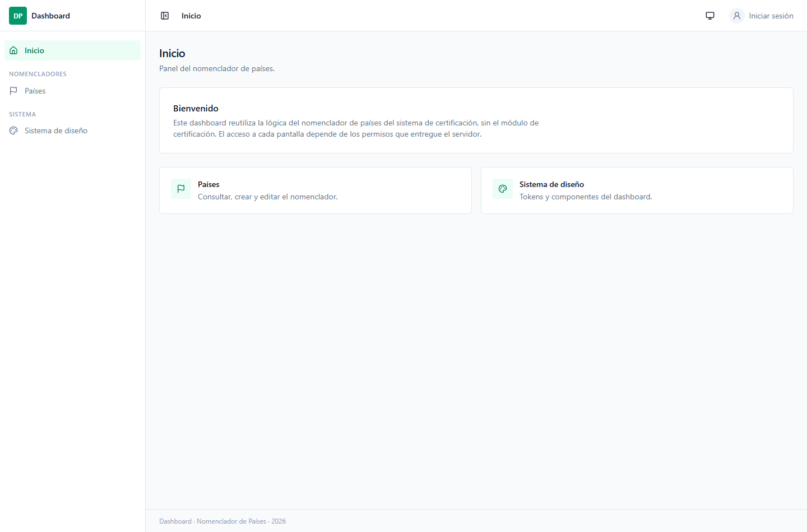 | 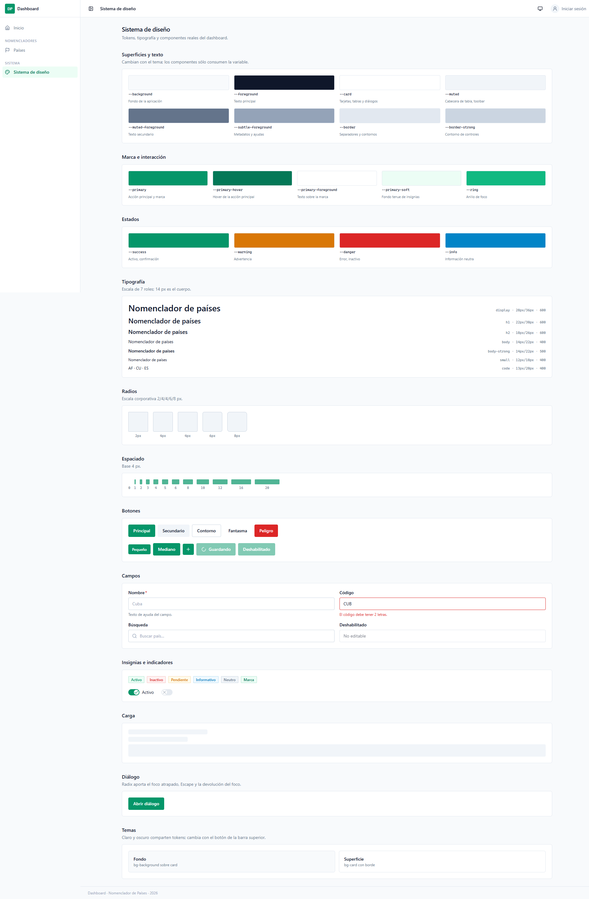 | 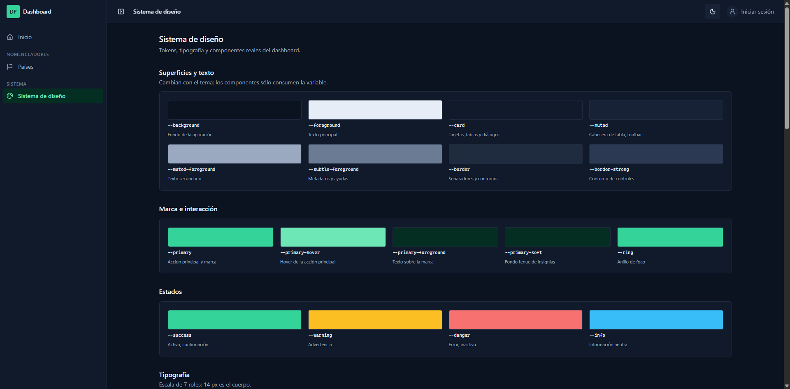 |

| RBAC: ruta sin permiso (usuario `sinautorizacion`)     |
| ------------------------------------------------------ |
| 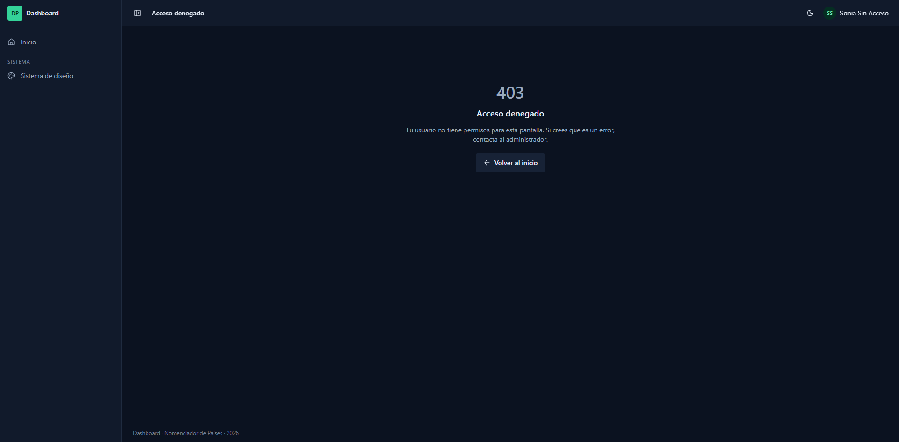 |

| Países · catálogo completo                    | Países · búsqueda «espana» (sin acentos)        |
| --------------------------------------------- | ----------------------------------------------- |
| 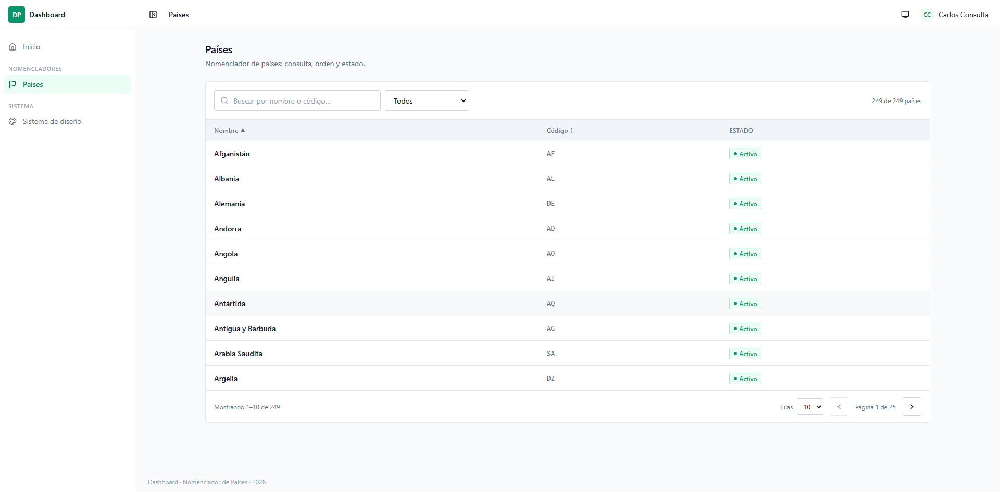 | 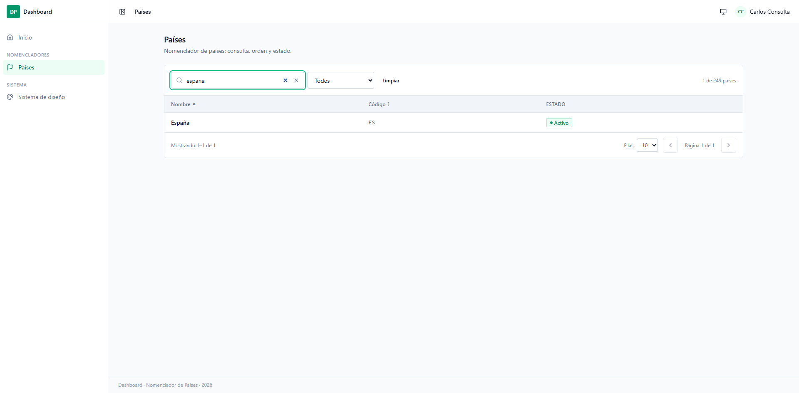 |

| Países · alta (diálogo)               | Países · creado y desactivado                 |
| ------------------------------------- | --------------------------------------------- |
| 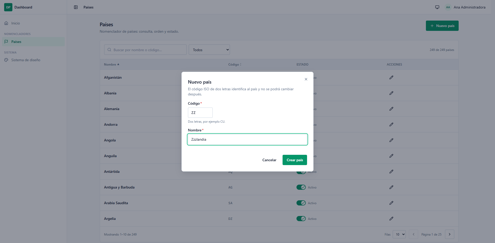 | 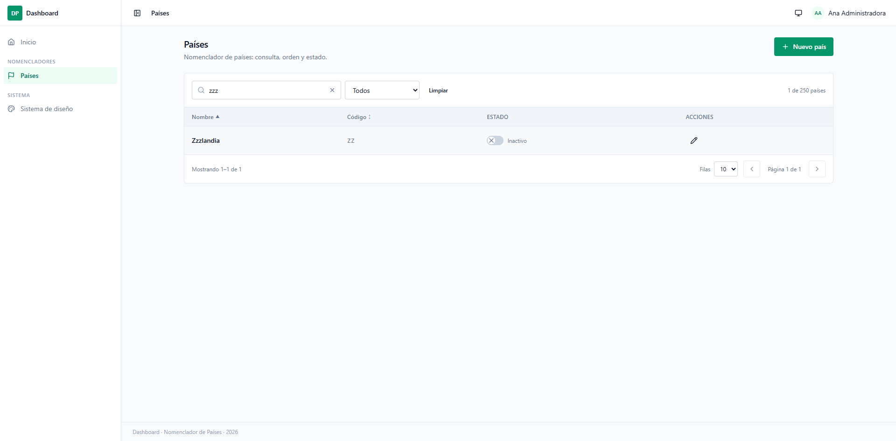 |

| Inicio con métricas                  | Detalle del país                       |
| ------------------------------------ | -------------------------------------- |
| 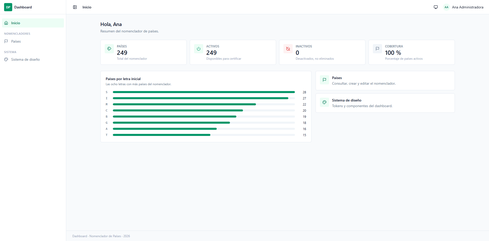 | 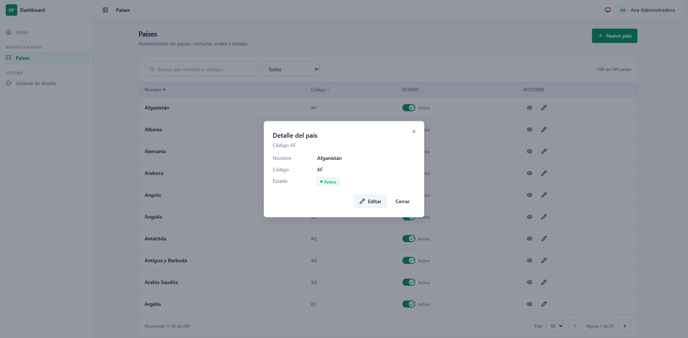 |

| Usuarios · administración de seguridad   | Alta de usuario                           |
| ---------------------------------------- | ----------------------------------------- |
| 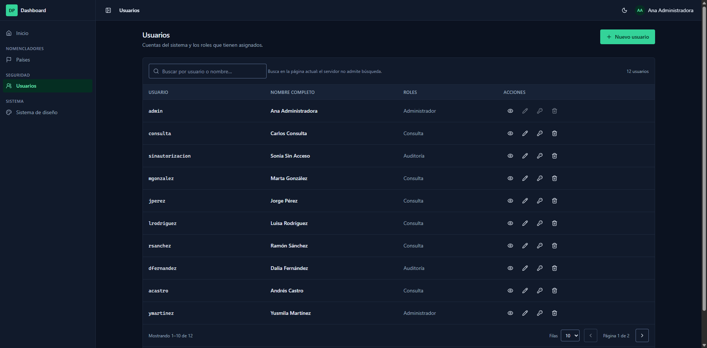 | 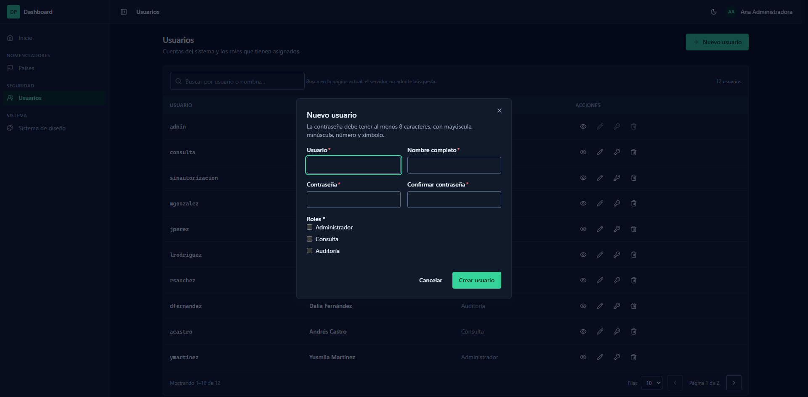 |

| Acciones de tabla · reposo                      | Acciones de tabla · hover                    |
| ----------------------------------------------- | -------------------------------------------- |
| 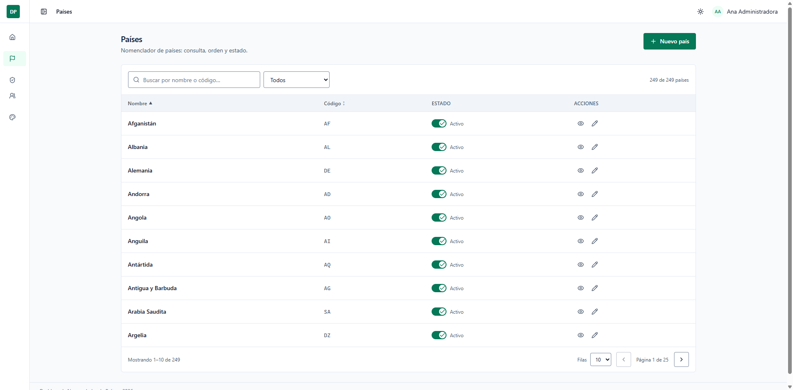 | 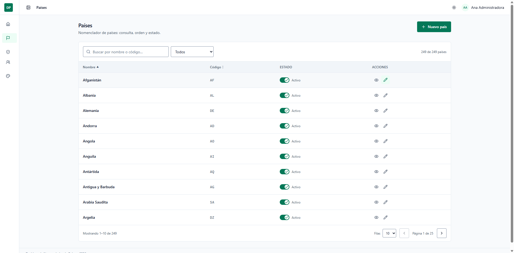 |

| Roles · permisos en tabla                | Roles · permisos en árbol                   |
| ---------------------------------------- | ------------------------------------------- |
| 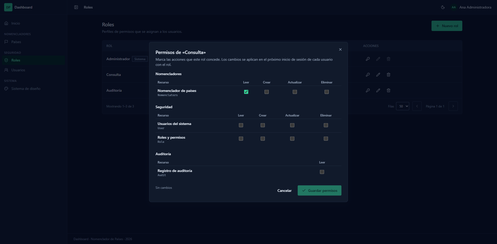 | 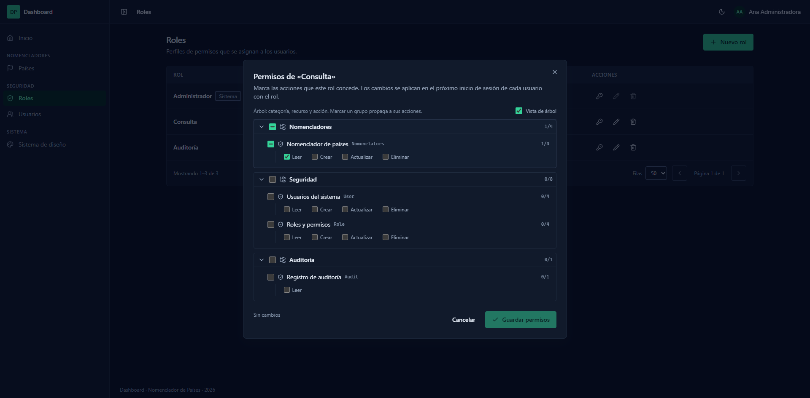 |

| Filtros conservados al volver por el menú                | Países · vista por defecto                    |
| -------------------------------------------------------- | --------------------------------------------- |
| 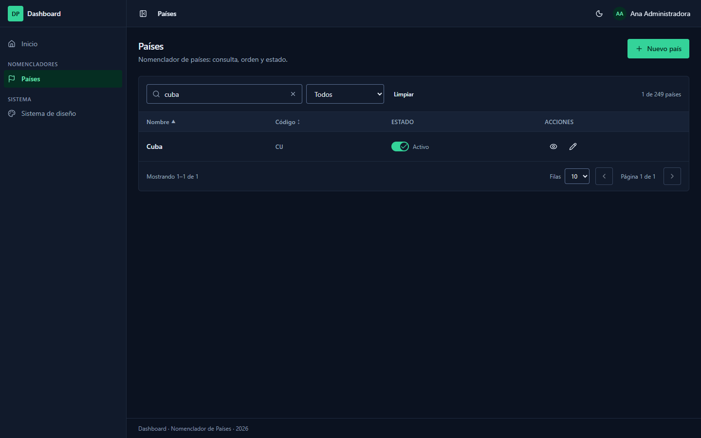 |  |

| Catálogo · componentes nuevos                        | Tabla del catálogo (tema oscuro)           |
| ---------------------------------------------------- | ------------------------------------------ |
| 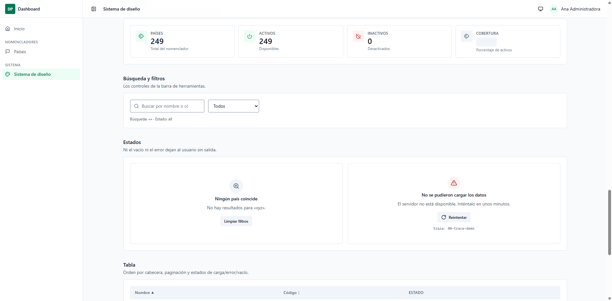 | 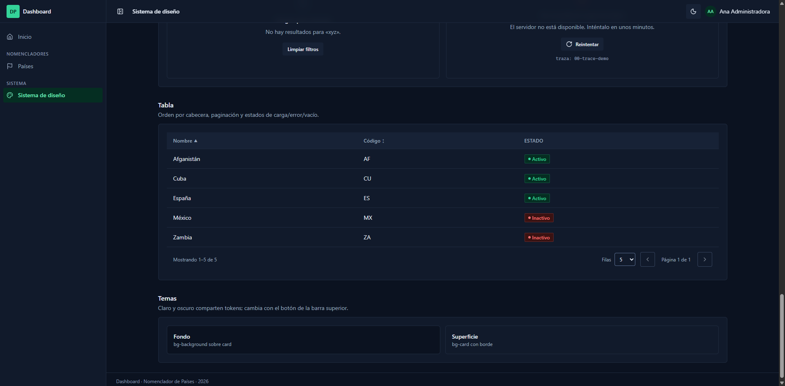 |

Generadas contra `http://localhost:5173` en modo `mock` (2026-11-20).
