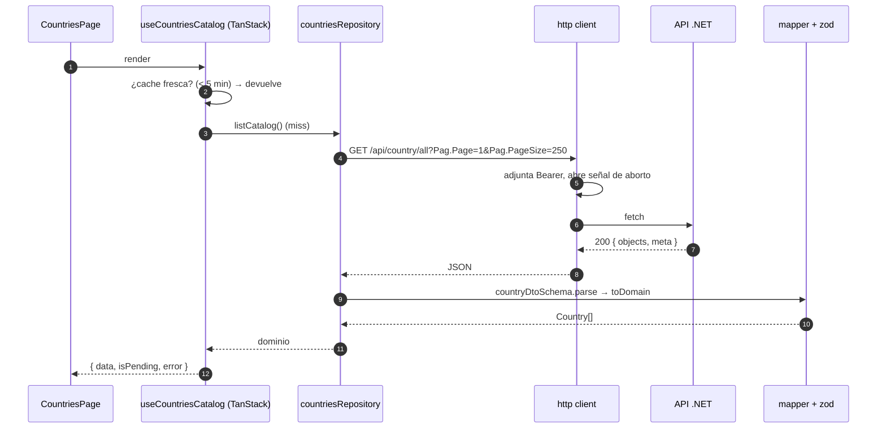
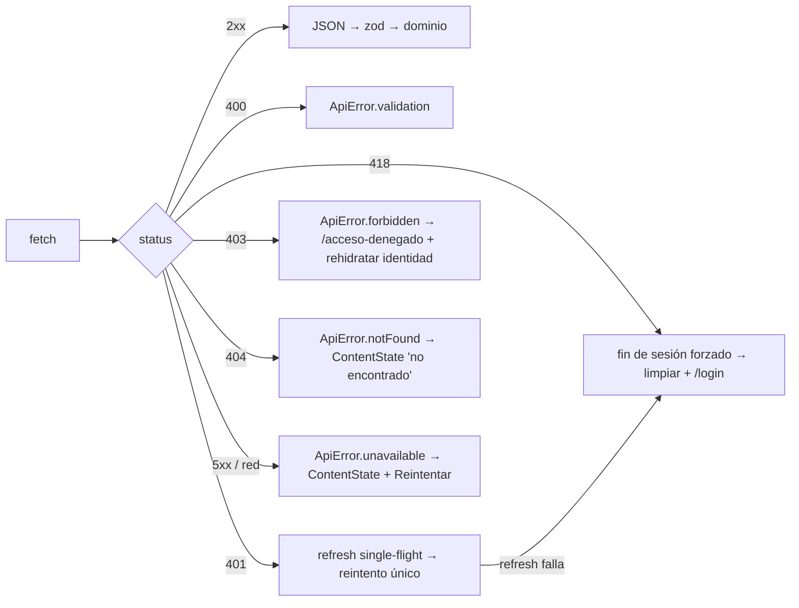

# 02 — Arquitectura

> **Fecha:** 2026-11-20 · **Estilo:** SPA React 19 con **vertical slices** y capas transversales mínimas.

---

## 1. Principios

1. **Vertical slice.** Cada feature contiene su dominio, su acceso a datos, su UI, su ruta y sus pruebas.
   Añadir una pantalla = añadir una carpeta, no tocar cinco capas repartidas por el repo.
2. **Dependencias unidireccionales.** `app → features → shared → design-system`. Nunca al revés, y
   **nunca entre features**.
3. **Un dueño por dato.** Cada dato tiene exactamente un lugar donde vive (ver §7).
4. **El dominio no conoce React ni HTTP.** `domain/` es TypeScript puro: se puede probar sin DOM.
5. **El borde traduce.** El DTO con el casing del wire vive en `api/dto.ts`; el mapper produce dominio.
   Un cambio de contrato se absorbe en un archivo.
6. **Lo compartido no sabe de negocio.** `shared/` recibe props; no importa `Country`.

---

## 2. Árbol de carpetas

```
dashboard-paises/
├── docs/                          # este paquete de documentación
├── e2e/                           # Playwright: flujos críticos
│   ├── auth.spec.ts
│   ├── countries.spec.ts
│   └── fixtures.ts
├── public/
├── src/
│   ├── app/
│   │   ├── main.tsx               # createRoot + providers
│   │   ├── providers.tsx          # QueryClient, Router, Toaster, tema
│   │   ├── router.tsx             # createBrowserRouter + rutas raíz
│   │   ├── error-boundary.tsx
│   │   └── shell/
│   │       ├── AppShell.tsx       # topbar + sidebar + outlet
│   │       ├── Sidebar.tsx
│   │       ├── Topbar.tsx         # breadcrumbs, usuario, tema
│   │       ├── Breadcrumbs.tsx
│   │       ├── nav.ts             # menú único, tipado y filtrado por RBAC
│   │       └── shell.spec.tsx
│   ├── core/                      # transversal sin UI de negocio
│   │   ├── config/
│   │   │   └── env.ts             # VITE_API_BASE_URL, VITE_API_MODE
│   │   ├── http/
│   │   │   ├── client.ts          # fetch + Bearer + refresh single-flight + 418
│   │   │   ├── params.ts          # QueryParams → query string (omite vacíos)
│   │   │   ├── problems.ts        # ProblemDetails → ApiError
│   │   │   └── types.ts           # QueryParams, PaginatedResponse, Filter, Sort
│   │   ├── auth/
│   │   │   ├── token-storage.ts   # ÚNICO dueño de los tokens
│   │   │   ├── session.store.ts   # Zustand: user + permissions + hasPermission
│   │   │   ├── session.api.ts     # login, refresh, logout, user/current
│   │   │   ├── login.use-case.ts  # orquesta IO + hidratación
│   │   │   ├── guards.ts          # requireAuth, requirePermission, guestOnly
│   │   │   └── Can.tsx            # RBAC de componente
│   │   ├── rbac/
│   │   │   ├── resources.ts       # RESOURCES (as const)
│   │   │   └── actions.ts         # ACTIONS (as const)
│   │   ├── query/
│   │   │   ├── query-client.ts    # defaults de ADR-004
│   │   │   └── keys.ts            # fábrica de query keys
│   │   ├── ui/
│   │   │   ├── theme.store.ts     # claro/oscuro, persistido
│   │   │   └── ui.store.ts        # sidebar, densidad
│   │   └── utils/                 # cn, formatters, date, string
│   ├── features/
│   │   ├── auth/
│   │   │   ├── domain/            # LoginCredentials, SessionUser, Permission
│   │   │   ├── api/               # dto + mapper + endpoints
│   │   │   ├── ui/                # LoginPage
│   │   │   ├── routes.tsx
│   │   │   └── index.ts           # superficie pública
│   │   ├── countries/
│   │   │   ├── domain/
│   │   │   │   ├── country.ts     # Country, CountryInput
│   │   │   │   └── schemas.ts     # zod: countryInputSchema, countryFilterSchema
│   │   │   ├── api/
│   │   │   │   ├── dto.ts         # CountryDto (casing del wire)
│   │   │   │   ├── mapper.ts      # toDomain / toWriteDto
│   │   │   │   ├── repositories.ts# endpoints: catalog, detail, create, update, activate, deactivate
│   │   │   │   ├── queries.ts     # useCountriesCatalog, useCountry
│   │   │   │   └── mutations.ts   # useCreateCountry, useUpdateCountry, useToggleCountry
│   │   │   ├── ui/
│   │   │   │   ├── CountriesPage.tsx
│   │   │   │   ├── CountryTable.tsx
│   │   │   │   ├── CountryFormDialog.tsx
│   │   │   │   ├── CountryDetailDialog.tsx
│   │   │   │   └── ActiveToggle.tsx
│   │   │   ├── routes.tsx
│   │   │   └── index.ts
│   │   └── dashboard/
│   │       ├── domain/            # métricas derivadas (puras)
│   │       ├── ui/DashboardPage.tsx
│   │       ├── routes.tsx
│   │       └── index.ts
│   ├── shared/
│   │   ├── ui/                    # shadcn: button, dialog, input, switch, table, toast…
│   │   ├── components/
│   │   │   ├── data-table/        # DataTable + columnas + toolbar + paginación
│   │   │   ├── content-state/     # loading → error(+Reintentar) → vacío → contenido
│   │   │   ├── page-header/
│   │   │   ├── search-input/
│   │   │   ├── empty-state/
│   │   │   ├── status-badge/
│   │   │   └── confirm-dialog/
│   │   ├── lib/                   # cn(), formatters de fecha/número
│   │   └── hooks/                 # useDebouncedValue, useMediaQuery, useOnline
│   ├── design-system/
│   │   ├── tokens.css             # ÚNICA fuente de color/tipografía/radios/sombras
│   │   ├── tokens.ts              # espejo tipado para el catálogo
│   │   └── catalog/               # ruta /design-system
│   ├── mocks/
│   │   ├── fixtures/countries.json
│   │   ├── handlers.ts
│   │   └── browser.ts
│   ├── styles.css                 # @import tailwind + tokens + base
│   └── vite-env.d.ts
├── index.html
├── vite.config.ts
├── vitest.setup.ts
├── playwright.config.ts
├── eslint.config.js
├── tsconfig.json / tsconfig.app.json / tsconfig.node.json
└── package.json
```

---

## 3. Arranque y composición

El orden de `src/main.tsx` es **contrato**, no estilo:

| #   | Paso                                           | Por qué no puede moverse                                                                                                                                                            |
| --- | ---------------------------------------------- | ----------------------------------------------------------------------------------------------------------------------------------------------------------------------------------- |
| 1   | MSW (solo `DEV` + `mock`) + sonda de readiness | La primera petición debe estar interceptada; `worker.start()` resuelve antes de que el worker atienda al cliente nuevo, así que se verifica con una sonda real (`waitForMockReady`) |
| 2   | `installAuth({ onSessionExpired })`            | Antes de esto no hay proveedor de tokens: cualquier petición saldría sin `Bearer`                                                                                                   |
| 3   | `createAppRouter()`                            | Crear el router **inicia la navegación y ejecuta los `loader`**. A nivel de módulo correrían antes de los pasos 1 y 2                                                               |
| 4   | `createRoot().render(<RouterProvider />)`      | Montaje                                                                                                                                                                             |

> **Fallo real (2026-11-20).** Con `createBrowserRouter` a nivel de módulo, un F5 disparaba el refresh
> **antes** de que existieran MSW y el proveedor de auth: la petición se escapaba al backend real, se
> recibía 401 y la sesión se cerraba sola. Se detectó mirando el orden real de las peticiones
> (`browser_network_requests`: el POST precedía a la sonda) y se corrigió con `createAppRouter()`.
> Ver [ADR-017](01-adr-stack.md#adr-017--orden-de-arranque-contrato-del-bootstrap).

**Providers globales:** solo dos (`QueryClientProvider` y `Toaster`). Todo lo demás es de dominio y vive
en las features.

---

## 4. Capas dentro de un slice

| Carpeta      | Contiene                                                                    | **No** contiene                      | Prueba                                     |
| ------------ | --------------------------------------------------------------------------- | ------------------------------------ | ------------------------------------------ |
| `domain/`    | Tipos, esquemas Zod, reglas puras, formatters del dominio                   | React, HTTP, `fetch`                 | Unitarias puras                            |
| `api/`       | DTO, mapper, endpoints, hooks de Query (queries y mutations)                | JSX                                  | Unitarias del mapper + integración con MSW |
| `ui/`        | Página, componentes, diálogos                                               | `fetch`, `axios`, lógica de contrato | Integración con RTL + MSW                  |
| `routes.tsx` | Objeto de ruta, `data` (`title`, `breadcrumb`, `resource`, `actions`), lazy | Estado                               | Integración de navegación                  |
| `index.ts`   | Superficie pública: lo único importable desde fuera                         | Detalles internos                    | —                                          |

**Regla de oro del borde:** un componente nunca toca un DTO. Si un `ui/` necesita `isUnitedState`, algo
está mal: ese campo se descarta en el mapper.

---

### Features de seguridad (ADR-019)

`users/` y `roles/` repiten el corte de `countries/`, sin excepciones:

```text
│   │   ├── users/
│   │   │   ├── domain/            # User, RoleRef, esquemas de alta y edición
│   │   │   ├── api/               # dto + mapper + repositories + queries + mutations
│   │   │   ├── ui/                # UsersPage, UserFormDialog, UserDetailDialog
│   │   │   └── index.ts
│   │   └── roles/
│   │       ├── domain/            # Role, Permission, ActionCommand
│   │       ├── api/               # listado, CRUD, catálogo y permisos por rol
│   │       ├── ui/                # RolesPage, RoleFormDialog, RolePermissionsDialog
│   │       └── index.ts
```

El editor de permisos es el único punto con estado local complejo (selección por recurso y acción): vive
en `roles/ui` con `useState` + `useMemo`, porque es estado de diálogo y muere al cerrarse.

---

## 5. Reglas de dependencia

| Desde → Hacia   | `app` |            `features/*`             | `core` |       `shared`       | `design-system` |
| --------------- | :---: | :---------------------------------: | :----: | :------------------: | :-------------: |
| `app`           |   —   |                 ✅                  |   ✅   |          ✅          |       ✅        |
| `features/*`    |  ❌   | ⚠️ **solo su `index.ts`** (ADR-020) |   ✅   |          ✅          |   ✅ (tokens)   |
| `core`          |  ❌   |                 ❌                  |   —    | ✅ solo `shared/lib` |       ❌        |
| `shared`        |  ❌   |                 ❌                  |   ❌   |          —           |   ✅ (tokens)   |
| `design-system` |  ❌   |                 ❌                  |   ❌   |    ✅ `shared/ui`    |        —        |

Se hace cumplir con **`src/app/architecture.spec.ts`**, que corre en el gate de pruebas: recorre los
archivos, resuelve cada import y falla si cruza una capa prohibida o si una feature importa otra. Se
descartó `eslint-plugin-boundaries` porque su versión actual está en API de transición (solo emite
deprecaciones) y no expresa la regla «una feature no importa otra».

---

## 6. Flujo de una lectura



**Escritura (toggle optimista):**

```mermaid
sequenceDiagram
    autonumber
    participant U as Usuario
    participant M as useToggleCountry
    participant C as QueryClient
    participant API as API

    U->>M: switch → false
    M->>C: onMutate: setQueryData (active=false) + guarda snapshot
    M->>API: DELETE /api/country/{code}
    alt 2xx
        API-->>M: 204
        M->>C: invalidate ['countries']
    else error
        API-->>M: ProblemDetails
        M->>C: onError: restaura snapshot
        M-->>U: toast de error
    end
    Note over M: la fila queda con pending mientras dura; el resto de la tabla sigue operable
```

---

## 7. Estado en cuatro capas

| Capa            | Dueño                        | Qué guarda                                               | Ejemplo                                         | Persistencia            |
| --------------- | ---------------------------- | -------------------------------------------------------- | ----------------------------------------------- | ----------------------- |
| **1. URL**      | `useSearchParams`            | Paginación, búsqueda, orden, filtro de estado            | `?page=2&q=cub&sort=name&dir=asc&status=active` | F5 y enlace compartible |
| **2. Servidor** | TanStack Query               | Catálogo, detalle, identidad                             | `['countries','catalog']`                       | Memoria (gcTime)        |
| **3. Cliente**  | Zustand                      | Sesión, tema, UI                                         | `useSessionStore.permissions`                   | Tema en `localStorage`  |
| **4. Local**    | `useState` / react-hook-form | Diálogo abierto, fila en edición, valores del formulario | `openDialog`                                    | Ninguna                 |

**Por qué la URL y no `sessionStorage` como dueño de los filtros:** el origen los persistía en
`sessionStorage` con un `STORAGE_VERSION` para invalidar. La URL consigue lo mismo (sobrevive F5) y además
permite compartir un listado filtrado y usar atrás/adelante del navegador. Se pierde la persistencia al
cerrar la pestaña: es el comportamiento deseado.

**Matiz (ADR-018):** la URL no cubre volver a la pantalla desde el menú, porque el enlace del sidebar no
lleva parámetros. Por eso `sessionStorage` vuelve, pero **solo como semilla**: guarda la última vista por
usuario y se aplica únicamente cuando la URL llega vacía. Si la URL trae cualquier parámetro, lo guardado
se ignora. El dueño del dato sigue siendo uno; el almacenamiento no compite.

**Query keys** (`core/query/keys.ts`) — nunca strings sueltos:

```ts
export const queryKeys = {
  countries: {
    all: ['countries'] as const,
    catalog: () => [...queryKeys.countries.all, 'catalog'] as const,
    detail: (code: string) => [...queryKeys.countries.all, 'detail', code] as const
  },
  auth: { currentUser: () => ['auth', 'current-user'] as const }
};
```

---

## 8. Errores, carga y permisos

### 7.1 Errores



Reglas:

- **Query:** el error se pinta en `ContentState` con botón **Reintentar** (`refetch`). Nunca un toast suelto.
- **Mutación:** toast con el mensaje del `ProblemDetails`; el formulario mantiene los valores.
- **`ProblemDetails`** (`title`, `detail`, `errors`, `traceId`) se traduce a un mensaje de usuario en
  `core/http/problems.ts`; el `traceId` se registra en consola para soporte.

### 7.2 Carga en tres niveles

| Nivel     | Dueño                                         | Indicador                                               |
| --------- | --------------------------------------------- | ------------------------------------------------------- |
| Global    | contador de `useIsFetching` + `useIsMutating` | barra fina superior con anti-parpadeo (150 ms / 300 ms) |
| Contenido | `ContentState` de cada query                  | skeleton propio de la pantalla                          |
| Fila      | `isPending` de la mutación                    | `switch`/botón deshabilitado + `aria-busy`              |

Prohibido: spinner de pantalla completa por una petición, `setTimeout` para "esperar" datos.

### 7.3 RBAC

`RESOURCES` y `ACTIONS` son constantes `as const` (equivalentes a las del origen: `Nomenclators`,
`Leer|Crear|Actualizar|Eliminar`). No se escriben strings a mano en ningún componente.

---

## 9. Recipe: añadir un slice nuevo

1. **Dominio** — `domain/<entidad>.ts` + `domain/schemas.ts` (Zod). Sin React.
2. **Contrato** — verificar en vivo el endpoint y documentarlo en `docs/03-contratos-api.md`.
3. **API** — `api/dto.ts`, `api/mapper.ts` (con spec), `api/repositories.ts`.
4. **Hooks** — `api/queries.ts` y `api/mutations.ts` con las query keys de `core/query/keys.ts`.
5. **UI** — página + componentes; estados `loading`, `error`, `empty` con `ContentState`.
6. **Ruta** — `routes.tsx` con `data: { title, breadcrumb, resource, actions }`; entrada en `shell/nav.ts`.
7. **Pruebas** — dominiomapper (unit), hook/repositorio (MSW), página (RTL), flujo (Playwright si es crítico).
8. **Gate** — `pnpm typecheck && pnpm lint && pnpm test && pnpm build`.

---

## 10. Lo que esta arquitectura deliberadamente **no** tiene

| No hay                         | Por qué                                                                           |
| ------------------------------ | --------------------------------------------------------------------------------- |
| Redux / RTK                    | TanStack Query + Zustand cubren servidor y cliente sin boilerplate                |
| `useEffect` de sincronización  | Todo lo derivado se computa; los efectos son para el DOM y el storage             |
| Capa de "servicios" con estado | El repositorio es una función pura; el estado es de Query                         |
| i18n                           | UI en español, un solo idioma; se añadiría con `i18next` si hiciera falta         |
| SSR                            | Panel interno tras login; Vite SPA es suficiente                                  |
| Monorepo                       | Un solo artefacto; si aparece un segundo consumidor, se extrae `shared` a paquete |
| Micro-frontends                | Un equipo y un despliegue                                                         |
